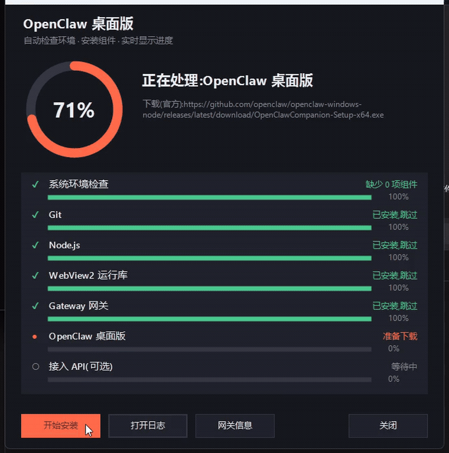

# OpenClaw One-Click Installer (Windows)

> Run one file: it checks your environment, installs the Gateway and the desktop app, and shows live progress.
> No more PowerShell incantations, and no more guessing which download stalled.

[](LICENSE)
[](https://github.com/wintxx399-coder/openclaw-easy-install/releases)
[](https://github.com/wintxx399-coder/openclaw-easy-install)

[简体中文](README.md) | **English**

## Preview



<sub>GIF not loading? See the [static screenshot](docs/screenshots/installer-wizard.png)</sub>

## Why this exists

The official install path is rough for newcomers:

- You have to open PowerShell, change the execution policy, and type commands one by one
- Installing Node / Git / WebView2 gives no progress feedback, so a stall looks like a freeze
- Failures print one red line and leave you guessing whether to retry or switch mirrors

This installer wraps all of that in a single wizard: **environment check → component install → download with checksum → desktop app → optional API setup**. Every step has a state, a percentage and a speed, and failures tell you the reason and where the log is.

## Quick start

1. Download this repo (**Code → Download ZIP**, or the `v1.0.0` release zip)
2. Unzip it, then double-click the `.bat` file inside `windows\`
3. Let the wizard finish. The API step is optional and can be skipped

**Requirements**: Windows 10 20H2 or newer / Windows 11, with `winget` available (bundled with Windows 11; on Windows 10 update "App Installer" from the Microsoft Store).

## What it does

| Step | Action | Required |
| --- | --- | --- |
| Environment check | Detects OS build and CPU architecture (x64 / arm64) | Yes |
| Git | Installs silently via winget when missing | Recommended |
| Node.js (v22+) | Installs the LTS build via winget when missing | Recommended |
| WebView2 runtime | Installs via winget when missing | Recommended |
| Gateway | Runs the official install script when missing | Optional |
| OpenClaw desktop | Downloads the official release, verifies SHA256, then installs | Yes |
| API setup (optional) | Pick DeepSeek / Anthropic, paste a key, written to local config | Optional |

A failed component step is marked "skipped" and does not abort the run. The desktop app is the only hard requirement, and it stops with a clear reason if it fails.

## If a download fails

The wizard uses upstream official URLs, which can be slow or blocked on some networks. **Do not wait it out—install that piece manually, then click "Start" again.** Completed steps are skipped automatically.

| Stuck on | Download from | Afterwards |
| --- | --- | --- |
| Git slow / stuck | https://git-scm.com/download/win | Reopen the `.bat` and click Start again |
| Node.js slow / stuck | https://nodejs.org/en/download | Same |
| WebView2 runtime | https://developer.microsoft.com/microsoft-edge/webview2/ | Same |
| OpenClaw desktop | https://github.com/openclaw/openclaw-windows-node/releases/latest | Install it yourself, then reopen the desktop app |

## Safety

- The desktop installer is verified against the official `promotion.json` **SHA256**; a mismatch deletes the file and stops.
- Mirrors (`gh-proxy.com`, `ghfast.top`) are only used after the official route fails. They are third-party services and could tamper with files, which is exactly why the checksum gate exists.
- API keys stay in memory, are written to your local `~/.openclaw` config, and never reach a server or the log.
- The whole script is in this repo—read `windows/Install-OpenClaw.ps1` before running it if you want.

## Skill package

`skills/Skill-一键安装器.md` is an install brief written for AI agents. Hand it to your agent (OpenClaw / Claude Code / Gemini CLI) and it will:

- Check Node / Git / uv
- Install the basics on demand: `windows-mcp` (computer control), `agent-browser` (browser control), `ego-lite` (macOS)
- Optionally add document-skills (Word/PDF/PPT/Excel), fetch, filesystem, memory, sequential-thinking
- Fall back to mirrors on download failure and back up config before editing it

It works as a human checklist too.

## FAQ

**The window flashes and disappears.**
Right-click the `.bat` → Run as administrator. If it still closes, run:
`powershell -NoProfile -ExecutionPolicy Bypass -File .\windows\Install-OpenClaw.ps1`

**"winget not found".**
On Windows 10, install or update "App Installer" from the Microsoft Store, or install Git / Node / WebView2 manually and rerun.

**Port 18789 is already in use.**
An existing CLI gateway is running. Run `openclaw gateway stop` first, then let the desktop app take over. The wizard's "Gateway info" button shows the current port and token.

**My antivirus flags it.**
It installs software silently and writes registry keys for detection—expected for an installer. Read the source first, or run only the steps you need.

## Layout

```
openclaw-easy-install/
├── README.md                 # Chinese
├── README.en.md              # English
├── LICENSE
├── docs/screenshots/
├── windows/
│   ├── 双击安装.bat           # entry point: double-click this
│   └── Install-OpenClaw.ps1   # the wizard
└── skills/
    └── Skill-一键安装器.md     # install brief for AI agents
```

## Disclaimer

A community helper, not affiliated with the OpenClaw project. Installed software remains under its own authors' licenses—evaluate the risk yourself before running.

## License

[MIT](LICENSE)
